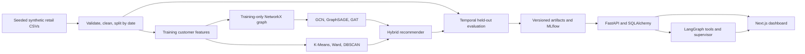

# Architecture and contracts

The ML layer performs offline computation. API startup never trains models. The API loads a single cached artifact set, returning 503 when artifacts are absent. Generated operational records are loaded into normalized SQLAlchemy tables in one transaction. Customer and product IDs are foreign keys for transactions, segments and recommendations; a transaction uses the basket/product composite primary key. Agent logs and reports persist independently of analytics.

All analytics sources carry a declared time scope. Segments use training-window features. Overview revenue and customer purchase histories include all dates. Graph exploration displays a bounded customer neighborhood with all relation types preserved in GraphML. Similar customers use standardized training behavior, while learned graph embeddings power the graph recommendation component.

The recommender combines five min-max normalized signals using fixed weights (0.25 collaborative, 0.15 content, 0.25 graph, 0.20 co-purchase, 0.15 segment). Item similarity is cosine similarity over training customer purchase counts. Content similarity uses category, product type, brand and scaled log price. Graph similarity is customer/product embedding cosine similarity. Co-purchase counts distinct observed baskets. Segment preference aggregates training activity for each assigned cluster. The score components and supporting purchases are returned for inspection.

The supervisor routes a question to one relevant tool agent. A report agent consumes validated evidence. LangGraph retry policy applies to transient tool failures; failures propagate to sanitized API errors and backend logs. Successful agent operations persist evidence and run IDs in SQL. Missing LLM credentials bypass the optional rewrite; provider failures return the deterministic summary. The workflow executes analytics rather than ungrounded agent-to-agent chat.

At this scale dense customer/item matrices and full-batch graph learning keep the experiment transparent and reproducible. Larger deployments need sparse recommenders, neighbor-sampled GNN training, asynchronous jobs, graph/data version binding, distributed storage and cold-start evaluation for new identities. API retraining is maintenance-only because multi-file artifact activation is not atomic; the current server is not designed for concurrent training and serving.
